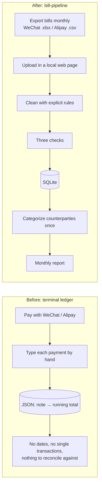

# bill-pipeline

A local data pipeline that collects, cleans, validates, stores and analyzes personal WeChat Pay and Alipay bills.

Upload the bills exported from the two apps into a local web page. The pipeline reads them, applies explicit cleaning rules, runs three checks, stores every transaction in SQLite, and shows how much was really spent each month, by category. It also explains, cent by cent, why that number differs from the total the apps display.

## Why

This project replaces my earlier terminal ledger. I typed every payment into it by hand, and it stored only a running total per note.



| Pain point (old ledger) | Improvement |
|---|---|
| Every payment typed by hand, so some get forgotten | Import the apps' own exports; nothing is typed by hand |
| Only "note → running total": no dates, no single transactions | One row per transaction: time, counterparty, amount, status |
| No way to check the numbers against the apps | A reconciliation table: platform total − exclusions = counted total |
| Each wallet shows only half of the spending | Both sources in one database and one monthly report |
| Refunds, transfers and wallet top-ups mixed into "spending" | Explicit cleaning rules; every excluded row carries a reason |

## Cleaning rules

Each row gets a result (`消费` spending / `收入` income / `不算` not counted / `未识别` unknown) and a reason. Chinese values below are the literal values in the exported files.

| Case | How it is recognized | How it counts | Decided by |
|---|---|---|---|
| Neutral (top-up, withdrawal, wealth products, repayments) | WeChat `收/支` is `/`; Alipay `不计收支` (stored as `/`) | Neither spending nor income | AI proposal |
| Failed or closed | Status `交易关闭` or `支付失败` | Not counted (no money moved) | AI proposal |
| Original of a fully refunded payment | `支出`, status `已全额退款` | Not spending | Author |
| The refund itself | `收入`, type ends with `-退款` or status `已全额退款` | Not income | Author |
| Partial refund | Status like `已退款(￥x)` | Spending = amount − refunded | Pending confirmation |
| WeChat merchant / QR-code payment | (`支出`, `商户消费`, `支付成功`), (`支出`, `扫二维码付款`, `已转账`) | Spending, categorized by counterparty | AI proposal |
| Money transferred out (split bills, paying friends back) | (`支出`, `转账`, `对方已收钱`) | Spending, category fixed to "Other" | Author |
| Red packet sent | (`支出`, `微信红包`) | Spending, "Other" | Pending confirmation |
| Money transferred in (allowance) | (`收入`, `转账`, `已存入零钱`) | Income | Author |
| Red packet received | (`收入`, `微信红包`, `已存入零钱`) | Income | Pending confirmation |
| Alipay payment | (`支出`, `交易成功`) | Spending, categorized by counterparty | AI proposal, pending confirmation |
| Anything never seen before | None of the above | Not guessed: flagged as unknown, excluded, listed in the report | AI proposal |

Spending is categorized by counterparty: the first import lists every uncategorized counterparty, and the user picks a category once. Later imports only ask about new ones.

## Validation

- **File checks**: the file must open; it must be a recognizable bill (title line, header row found by the column name `交易时间`, all required columns present); Alipay files must decode as UTF-8 or GBK. Otherwise the file is rejected with the reason and, where possible, the line number.
- **Check 1: completeness (control totals).** Row counts and amounts for income, spending and neutral rows must equal the summary lines that the platform writes above the table.
- **Check 2: reconciliation.** For each direction, platform total − every excluded group = counted total. A mismatch means a rule is wrong, and the whole file is rejected. The import report shows this table.
- **Check 3: no duplicates.** The key is (source, transaction id). Re-importing a file, or exports whose periods overlap, skip rows already stored. Duplicate ids inside one file reject it.
- **All or nothing.** Each file is stored in one database transaction; any error rolls everything back.
- **Money is integer cents,** never floats, so reconciliation matches to the cent.

## Privacy

- Runs only on this computer. Streamlit listens on localhost only, and its usage statistics are turned off (`.streamlit/config.toml`).
- Real bills and the database stay out of Git (`.gitignore`). Tests use generated fake bills.
- This version calls no AI service and needs no network.

## How to run

```bash
python3.13 -m venv .venv
.venv/bin/pip install -r requirements.txt
.venv/bin/streamlit run app.py
```

Run the tests:

```bash
.venv/bin/pytest
```

Exporting the bills:

- **WeChat**: Me → Services → Wallet → Bills → FAQ → Download bills → For personal reconciliation. At most 3 months per export; the password for the zip arrives in the WeChat Pay chat. The file inside is `.xlsx`.
- **Alipay**: Me → Bills → ··· → Transaction statement → For personal reconciliation. The file inside the zip is a GBK-encoded `.csv`.

## Project structure

```
bill_pipeline/
  model.py      shared types: BillError, Summary, ParsedBill
  convert.py    money to integer cents, timestamps, display
  header.py     summary lines and period above the table header
  wechat.py     WeChat .xlsx reader
  alipay.py     Alipay .csv reader
  rules.py      cleaning rules
  validate.py   check 1, duplicate ids, check 2 (reconciliation)
  db.py         SQLite schema, all-or-nothing import, categories, monthly queries
  pipeline.py   read → check → clean → reconcile → store
app.py          Streamlit page
tests/          pytest suite with generated fake bills
docs/           design document and implementation plan (Chinese)
```

## Credits

Requirements, cleaning rules and validation design by Huang Fei. Code written with AI coding assistance (Claude Code).

## Roadmap

- AI-suggested categories for uncategorized counterparties, confirmed by the user.
- Natural-language questions over the database through a separate agent project.
- Recategorizing single transactions, for example a split-bill transfer that should count as sports.
