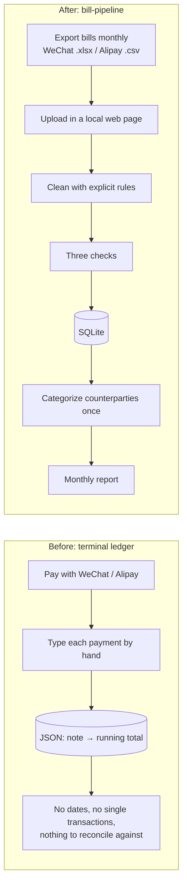

# bill-pipeline

A local data pipeline that collects, cleans, validates, stores and analyzes personal WeChat Pay and Alipay bills.

Upload the bills exported from the two apps into a local web page. The pipeline reads them, applies explicit cleaning rules, runs three checks, stores every transaction in SQLite, and shows how much was really spent each month, by category. It also explains, cent by cent, why that number differs from the total the apps display.

## Why

This project replaces my earlier terminal ledger. I typed every payment into it by hand, and it stored only a running total per note.



| Pain point (old ledger) | Improvement |
|---|---|
| Every payment typed by hand, so some get forgotten | Import the apps' own exports; nothing is typed by hand |
| Only "note → running total": no dates, no single transactions | One row per transaction: time, counterparty, amount, status |
| No way to check the numbers against the apps | A reconciliation table: platform total − exclusions = counted total |
| Each wallet shows only half of the spending | Both sources in one database and one monthly report |
| Refunds, transfers and wallet top-ups mixed into "spending" | Explicit cleaning rules; every excluded row carries a reason |

## Cleaning rules

Each row gets a result (`消费` spending / `收入` income / `不算` not counted / `未识别` unknown) and a reason. Chinese values below are the literal values in the exported files.

| Case | How it is recognized | How it counts | Decided by |
|---|---|---|---|
| Neutral (top-up, withdrawal, wealth products, repayments) | WeChat `收/支` is `/`; Alipay `不计收支` (stored as `/`) | Neither spending nor income | AI proposal |
| Failed or closed | Status `交易关闭` or `支付失败` | Not counted (no money moved) | AI proposal |
| Original of a fully refunded payment | `支出`, status `已全额退款` | Not spending | Author |
| The refund itself | `收入`, type ends with `-退款` or status `已全额退款` | Not income | Author |
| Partial refund | Status like `已退款(￥x)` | Original amount provisionally; manual review required | Unverified export format |
| WeChat merchant / QR-code payment | (`支出`, `商户消费`, `支付成功`), (`支出`, `扫二维码付款`, `已转账`) | Spending, categorized by counterparty | AI proposal |
| Another WeChat payment type | (`支出`, `消费-其他`, `支付成功`) | Spending, categorized by counterparty | Author |
| Money transferred out (split bills, paying friends back) | (`支出`, `转账`, `对方已收钱`) | Spending, category fixed to "Other" | Author |
| Transfer returned by the recipient | (`支出`, `转账`, `对方已退还`) | Not counted (the money came back) | Author |
| Red packet sent | (`支出`, `微信红包`) | Spending, "Other" | AI proposal |
| Money transferred in (allowance) | (`收入`, `转账`, `已存入零钱`) | Income | Author |
| Red packet received | (`收入`, `微信红包`, `已存入零钱`) | Income | AI proposal |
| Money received through my QR code | (`收入`, `二维码收款`, `已收钱`) | Income | Author |
| Alipay payment | (`支出`, `交易成功`) | Spending, categorized by counterparty | AI proposal |
| Anything never seen before | None of the above | Not guessed: flagged as unknown, excluded, listed in the report | AI proposal |

Spending is categorized by counterparty: the first import lists every uncategorized counterparty, and the user picks a category once. Later imports only ask about new ones.

When a rule is added, stored rows that were unknown are re-classified the next time the page opens.

## Validation

- **File checks**: the file must open; it must be a recognizable bill (title line, header row found by the column name `交易时间`, all required columns present); Alipay files must decode as UTF-8 or GBK. Otherwise the file is rejected with the reason and, where possible, the line number.
- **Check 1: completeness (control totals).** Row counts and amounts for income, spending and neutral rows must equal the summary lines that the platform writes above the table.
- **Check 2: reconciliation.** For each direction, platform total − every excluded group = counted total. A mismatch means a rule is wrong, and the whole file is rejected. The import report shows this table.
- **Check 3: no duplicates.** The key is (source, transaction id). Re-importing a file, or exports whose periods overlap, skip rows already stored. Duplicate ids inside one file reject it.
- **All or nothing.** Each file is stored in one database transaction; any error rolls everything back.
- **Money is integer cents,** never floats, so reconciliation matches to the cent.

## Privacy

- Runs only on this computer. The NiceGUI server listens on `127.0.0.1` only (NiceGUI's default would be `0.0.0.0`, reachable from the local network), and all front-end files (Vue, Quasar, ECharts, fonts) ship inside the package, so the page loads nothing from the internet.
- Real bills and the database stay out of Git (`.gitignore`). Tests use generated fake bills.
- Importing, cleaning, checking and the reports never touch the network. Only the two optional AI features do; see [AI](#ai).

## AI

Two optional features use an OpenAI-compatible chat API, such as DeepSeek. Without a key everything else works, and the AI parts say what is missing.

- **Category suggestions.** When the Categorize view opens, uncategorized merchants are sent to the model in batches of 20, each with its name, Alipay's own category and the latest item description. The model must pick one of the user's existing categories; anything else is dropped. Each card shows the suggestion with a one-click accept, and the view tracks how many confirmed suggestions were right.
- **Questions.** The Ask view answers questions such as "how much did I spend on sports in October" through function calling. The model can only call six read-only queries (months, month summary, category detail, daily spending, top counterparties, transaction search), must answer from their results, and gets at most five steps. Each answer lists the queries that ran.

What leaves the computer: merchant names, amounts, dates, item descriptions, categories and the question. People are not sent: a counterparty with transfers, red packets, or personal QR-code payments or receipts gets no suggestion and appears as "个人收款" in query results. Transaction ids, order ids, account numbers, payment methods and notes are never sent.

Configure it in `.env` at the project root (ignored by Git):

```
OPENAI_API_KEY=...
OPENAI_BASE_URL=https://api.deepseek.com
AGENT_MODEL=deepseek-flash
```

Evaluate on your own database. Both modes call the API, cost a little, and print only counts. `ask` checks answers against amounts computed from the database; `suggest` sends the merchants you have already categorized, without your categories, and counts how many the model gets right.

```bash
.venv/bin/python -m scripts.eval_ai ask
.venv/bin/python -m scripts.eval_ai suggest
```

Tests never call the API: a fake client replays scripted replies, and `tests/conftest.py` hides any real key.

## How to run

```bash
python3.13 -m venv .venv
.venv/bin/pip install -r requirements.txt
.venv/bin/python main.py
```

Then open http://127.0.0.1:8080. The page has six views, each answering one question: **Overview** (how much this month, and on what), **Trend** (daily and monthly spending), **Import** (is this bill trustworthy), **Categorize** (one counterparty at a time), **Reconcile** (where the difference between the platform total and real spending went), **Ask** (questions about your spending; needs the AI key).

Run the tests:

```bash
.venv/bin/pytest
```

Exporting the bills:

- **WeChat**: Me → Services → Wallet → Bills → FAQ → Download bills → For personal reconciliation. At most 3 months per export; the password for the zip arrives in the WeChat Pay chat. The file inside is `.xlsx`.
- **Alipay**: Me → Bills → ··· → Transaction statement → For personal reconciliation. The file inside the zip is a GBK-encoded `.csv`.

## Project structure

```
bill_pipeline/
  model.py      shared types: BillError, Summary, ParsedBill
  convert.py    money to integer cents, timestamps, display
  header.py     summary lines and period above the table header
  wechat.py     WeChat .xlsx reader
  alipay.py     Alipay .csv reader
  rules.py      cleaning rules
  validate.py   check 1, duplicate ids, check 2 (reconciliation)
  db.py         SQLite schema, all-or-nothing import, categories, monthly queries
  pipeline.py   read → check → clean → reconcile → store
  report.py     month-level views: previous month, change, monthly reconciliation
  ai.py         model client from .env, category suggestions
  assistant.py  read-only query tools and the function-calling loop
web/
  theme.py      colors, CSS and ECharts options (pure functions)
  pages.py      the NiceGUI page: navigation rail and six views
main.py         entry point (binds 127.0.0.1)
scripts/        eval_ai.py: accuracy of the assistant on the local database
tests/          pytest suite with generated fake bills, plus NiceGUI simulated-user tests
docs/           design document (Chinese)
```

## Known limitations

- **Unverified refund formats.** Alipay refund exports and partial-refund variants remain unverified. Refund-like records are flagged for local review; the app does not guess net amounts or automatically match by merchant name/amount.
- **Coverage metadata.** Old imports or exports without a trustworthy generation time/all-transactions declaration remain “coverage unconfirmed”. Re-imports capture available metadata; missing periods are never estimated as zero spending.
- **Personal adjustments.** Refund links, per-transaction category splits and AA allocations require explicit confirmation. Source changes can suspend adjustments until reviewed. AA repayment currently requires a recognized income record; unknown income types need a verified rule first.
- **AI history.** Conversations are saved only in the local SQLite database, not encrypted by default. New questions send bounded context to the configured model. Old answers are flagged after data changes; opening history does not invoke the model.

## Local review and history

The **核查** page supports refund evidence, single-transaction categories/splits, counterparty aliases and recoverable advances. Categories save with one click and offer undo. Refunds and ordinary AA repayments share one return form; AA groups are created internally. Advanced splits, unpaid advances and evidence management stay under More operations. Source conflicts retain confirmation previews, which are rejected if data changed. Source file checks remain separate from personal accounting adjustments.

Database upgrades create an SQLite backup in `data/backups/` before applying transactional schema changes. Source observations are retained; re-imports distinguish new, updated, duplicate and conflicting transactions. Older exports cannot silently revert a confirmed full refund.

The answer page includes **本机会话** with rename, soft-delete/restore and explicitly confirmed permanent deletion. Restarting does not automatically resume paid model requests. Deleted data can remain in older local backups.

## Credits

Requirements, cleaning rules and validation design by Huang Fei. Code written with AI coding assistance (Claude Code).

## Roadmap

- Renaming and deleting categories (this version can only add them).
- Validate additional real refund formats before adding automatic interpretation.
